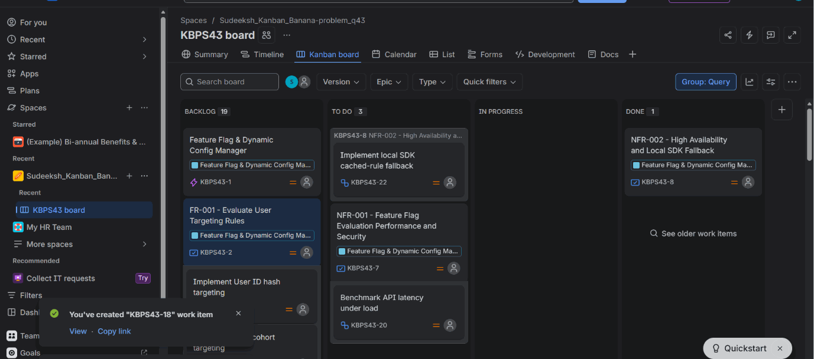
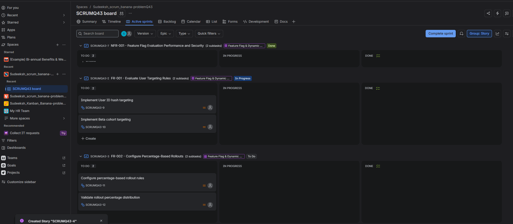
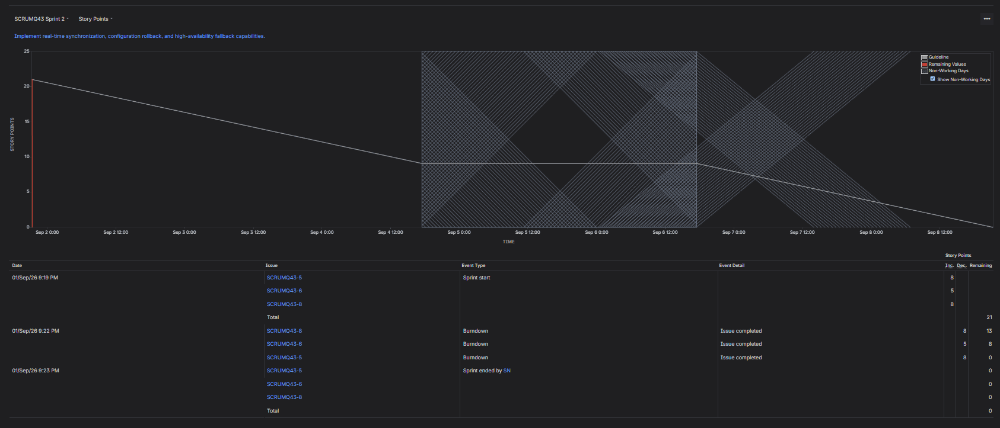
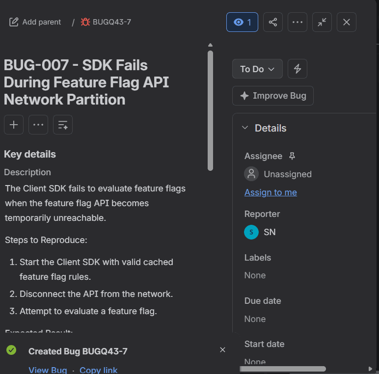

# Software Engineering Lab 2: Agile Backlog Creation & Sprint Simulation in Jira

**Course**: Software Engineering Lab — PES University (Dept. of CSE)  
**Student Name**: Sudeeksh Nayak  
**SRN**: `PES1UG24CS474`  
**Problem Statement ID**: #43  
**Domain**: Developer Tools & IT Operations  
**Topic**: Feature Flag & Dynamic Config Manager  

---

## Deliverables Summary

| Deliverable File | Format | Description |
|---|---|---|
| [`SOFTWARE_ENGINEERING_LAB2_PES1UG24CS474.pdf`](SOFTWARE_ENGINEERING_LAB2_PES1UG24CS474.pdf) | PDF (`.pdf`) | Complete 14-page report containing project creation, Kanban board, Scrum backlog, story points, sprint simulation, burndown charts, bug tracker, and answers to reflection questions. |
| [`SOFTWARE_ENGINEERING_LAB2_PES1UG24CS474.docx`](SOFTWARE_ENGINEERING_LAB2_PES1UG24CS474.docx) | Word (`.docx`) | Original Microsoft Word document report with all 23 embedded Jira screenshots and detailed captions. |
| [`Lab_2_Jira_Student_Handout.pdf`](Lab_2_Jira_Student_Handout.pdf) | PDF (`.pdf`) | Official lab handout detailing Agile/Scrum concepts, Jira configuration steps, and deliverable guidelines. |
| [`Screenshots/`](Screenshots/) | Directory | Complete set of 23 high-resolution Jira screenshots covering Kanban, Scrum, Sprints, Burndown, and Bug Tracking. |

---

## 1. System Requirements to Agile Backlog Mapping

The functional and non-functional requirements established in **Lab 1 (Problem Statement #43)** were translated into an Agile backlog comprising an overarching **Epic**, decomposed **User Stories**, and granular **Tasks & Subtasks**.

### Epic Overview
- **Epic Key**: `FF-EPIC-1`
- **Epic Name**: Feature Flag & Dynamic Config Manager Platform
- **Description**: Centralized configuration and feature toggling platform supporting percentage-based user cohort rollouts, environment overrides, real-time client SDK flag synchronization, low-latency evaluation, and local SDK cache fallback.

### User Stories & Fibonacci Story Point Estimation

| Story ID | Requirement Ref | User Story | Priority | Story Points (Fibonacci) |
|---|---|---|---|:---:|
| **US-01** | FR-001 | *As a Software Engineer*, I want to evaluate user targeting rules based on User ID hashes and beta cohorts, *so that* features can be selectively enabled for specific user segments. | High | **5** |
| **US-02** | FR-002 | *As a Release Manager*, I want to configure percentage-based rollout rules across environments, *so that* new features can be rolled out gradually with minimal blast radius. | High | **8** |
| **US-03** | FR-003 | *As a Software Engineer*, I want to define environment-specific configuration overrides (Dev, Staging, Prod), *so that* unreleased features remain safely isolated from live production traffic. | High | **5** |
| **US-04** | FR-004 | *As a Client Application Developer*, I want the system to push real-time flag updates via SSE or WebSockets, *so that* flag state changes take effect immediately without requiring app restarts. | Medium | **5** |
| **US-05** | FR-005 | *As a Release Manager*, I want an immutable audit log of all flag changes and instant rollback capabilities, *so that* bad configurations can be reverted within seconds during incidents. | Medium | **3** |
| **US-06** | NFR-001 | *As a System Architect*, I want the flag evaluation API to respond within 15 ms (p99), *so that* feature flag lookups do not degrade host application performance. | High | **8** |
| **US-07** | NFR-002 | *As a Site Reliability Engineer*, I want the Client SDK to fall back to local cached rules during network partitions, *so that* applications maintain 99.99% uptime without throwing exceptions. | High | **5** |

---

## 2. Jira Implementation & Workflows

### A. Kanban Board Implementation
- Created a dedicated Kanban project in Jira for continuous delivery tracking.
- Set up Kanban workflow columns: **Backlog → Selected for Development → In Progress → Done**.
- Mapped work items, tasks, and subtasks across the visual workflow.

### B. Scrum Board & Sprint Simulation
- Configured a Scrum project in Jira with time-boxed sprints (1-week duration).
- Populated the product backlog with all 7 User Stories and assigned story points using Planning Poker / Fibonacci scale.
- **Sprint 1 Simulation**: Populated with core prioritized stories (US-01, US-02, US-03, US-06). Successfully moved work items from **To Do → In Progress → Done**.
- **Sprint 2 Simulation**: Populated with remaining stories (US-04, US-05, US-07) and completed the sprint cycle.

### C. Burndown Chart Analysis
- Monitored work progress across sprints using Jira's **Burndown Chart**.
- Analyzed the actual burndown line against the guideline to assess velocity, team capacity, and scope management.

### D. Bug Tracking
- Set up a Bug Tracking project in Jira for Problem Statement #43.
- Documented issue summaries, reproduction steps, expected results, actual results, severity ratings, and associations to affected requirements.

---

## 3. Reflection Questions & Answers

### 1. Did your estimations reflect the actual effort?
> **Answer**: Yes, the Fibonacci story-point estimates generally reflected the complexity and effort required for each requirement. Higher-point stories (such as 8 points for percentage rollout algorithms and low-latency evaluation under high load) involved multiple algorithmic edge cases and distributed state synchronization, whereas smaller tasks (such as 3 points for audit log version rollbacks) were straightforward database queries and state updates.

### 2. Was your backlog well-prioritized?
> **Answer**: Yes, the backlog was prioritized based on business impact, architectural dependencies, and risk reduction. Core feature evaluation (`US-01`), rollout logic (`US-02`), and performance / latency guarantees (`US-06`) were prioritized in Sprint 1 because all subsequent features (SSE synchronization, audit logging, and fallbacks) depend on a functional, stable core evaluation engine.

### 3. How did your simulated sprint align with your plan?
> **Answer**: The simulated sprints closely aligned with the initial plan. In Sprint 1, the high-priority core requirements were successfully transitioned through the lifecycle from **To Do** to **In Progress** and ultimately to **Done**. Sprint 2 completed the remaining real-time synchronization, auditing, and fault-tolerance stories without carrying over uncompleted story points.

### 4. What insights did the burndown chart give about your team's capacity?
> **Answer**: The burndown chart provided clear visibility into the rate of work completion across the sprint duration. Tracking the remaining story points against the ideal guideline helped identify steady progress, validated that the team committed to an achievable velocity (approximately 20–26 story points per sprint), and confirmed that breaking requirements into smaller subtasks prevents steep "waterfall-style" drops near sprint completion.

---

## 4. Screenshot Index

| Screenshot File | Stage | Description |
|---|---|---|
| [`Screenshots/Kanban_01_Project_Creation.png`](Screenshots/Kanban_01_Project_Creation.png) | Kanban | Creation of Kanban project for Problem Statement #43 in Jira |
| [`Screenshots/Kanban_02_Epic_Creation.png`](Screenshots/Kanban_02_Epic_Creation.png) | Kanban | Epic creation for Feature Flag & Dynamic Config Manager |
| [`Screenshots/Kanban_03_User_Stories_Part1.png`](Screenshots/Kanban_03_User_Stories_Part1.png) | Kanban | User stories corresponding to functional requirements (Part 1) |
| [`Screenshots/Kanban_03_User_Stories_Part2.png`](Screenshots/Kanban_03_User_Stories_Part2.png) | Kanban | User stories corresponding to functional requirements (Part 2) |
| [`Screenshots/Kanban_04_Tasks_and_Subtasks.png`](Screenshots/Kanban_04_Tasks_and_Subtasks.png) | Kanban | Detailed task and subtask breakdown |
| [`Screenshots/Kanban_05_Backlog.png`](Screenshots/Kanban_05_Backlog.png) | Kanban | Organized Kanban product backlog |
| [`Screenshots/Kanban_06_Workflow_Status.png`](Screenshots/Kanban_06_Workflow_Status.png) | Kanban | Workflow column status configuration |
| [`Screenshots/Kanban_06_Board_View.png`](Screenshots/Kanban_06_Board_View.png) | Kanban | Active Kanban board view with work items |
| [`Screenshots/Scrum_01_Project_Creation.png`](Screenshots/Scrum_01_Project_Creation.png) | Scrum | Creation of Scrum development project in Jira |
| [`Screenshots/Scrum_02_Epic_Creation.png`](Screenshots/Scrum_02_Epic_Creation.png) | Scrum | Epic configuration under Scrum project |
| [`Screenshots/Scrum_03_User_Stories.png`](Screenshots/Scrum_03_User_Stories.png) | Scrum | Full set of 7 User Stories in Scrum backlog |
| [`Screenshots/Scrum_04_Tasks_and_Subtasks.png`](Screenshots/Scrum_04_Tasks_and_Subtasks.png) | Scrum | Requirement decomposition into implementation tasks |
| [`Screenshots/Scrum_05_Prioritized_Backlog.png`](Screenshots/Scrum_05_Prioritized_Backlog.png) | Scrum | Prioritized backlog ranked by business impact |
| [`Screenshots/Scrum_06_Story_Points_Fibonacci.png`](Screenshots/Scrum_06_Story_Points_Fibonacci.png) | Scrum | Story point estimation using Fibonacci sequence |
| [`Screenshots/Scrum_07_Sprint1_Backlog.png`](Screenshots/Scrum_07_Sprint1_Backlog.png) | Scrum | Sprint 1 backlog populated with prioritized user stories |
| [`Screenshots/Scrum_08_Sprint1_Progress_ToDo.png`](Screenshots/Scrum_08_Sprint1_Progress_ToDo.png) | Scrum | Sprint 1 active board with tasks in To Do |
| [`Screenshots/Scrum_08_Sprint1_Progress_Done.png`](Screenshots/Scrum_08_Sprint1_Progress_Done.png) | Scrum | Sprint 1 completed with all tasks in Done |
| [`Screenshots/Scrum_09_Sprint2_Backlog.png`](Screenshots/Scrum_09_Sprint2_Backlog.png) | Scrum | Sprint 2 populated with remaining user stories |
| [`Screenshots/Scrum_10_Sprint2_Active_Board.png`](Screenshots/Scrum_10_Sprint2_Active_Board.png) | Scrum | Sprint 2 active board tracking progress |
| [`Screenshots/Scrum_11_Burndown_Chart.png`](Screenshots/Scrum_11_Burndown_Chart.png) | Scrum | Jira Burndown Chart showing remaining work vs guideline |
| [`Screenshots/BugTracker_01_Project_Creation.png`](Screenshots/BugTracker_01_Project_Creation.png) | Bug Tracker | Bug tracking project creation in Jira |
| [`Screenshots/BugTracker_02_Issue_List.png`](Screenshots/BugTracker_02_Issue_List.png) | Bug Tracker | List of reported bugs linked to requirements |
| [`Screenshots/BugTracker_03_Detailed_Bug_Report.png`](Screenshots/BugTracker_03_Detailed_Bug_Report.png) | Bug Tracker | Detailed bug report with reproduction steps & expected result |
