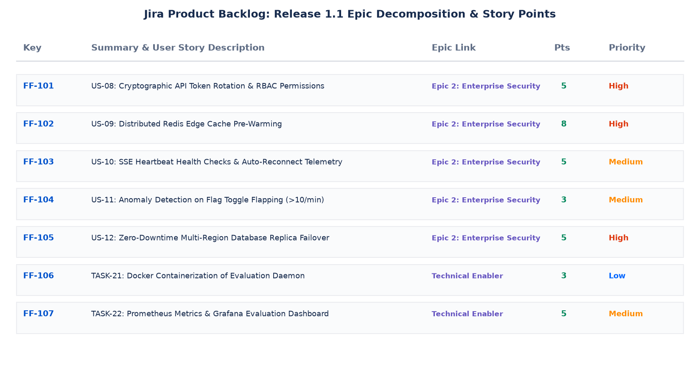
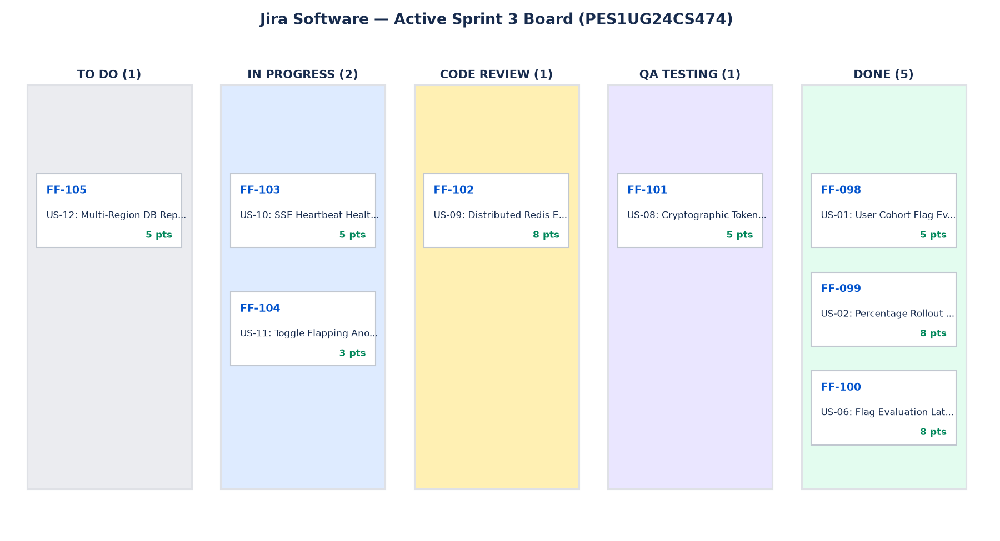
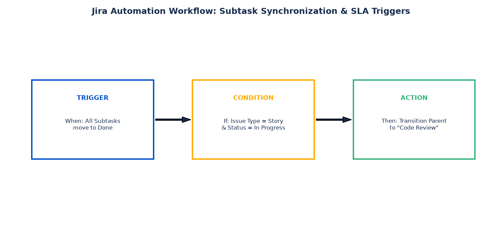
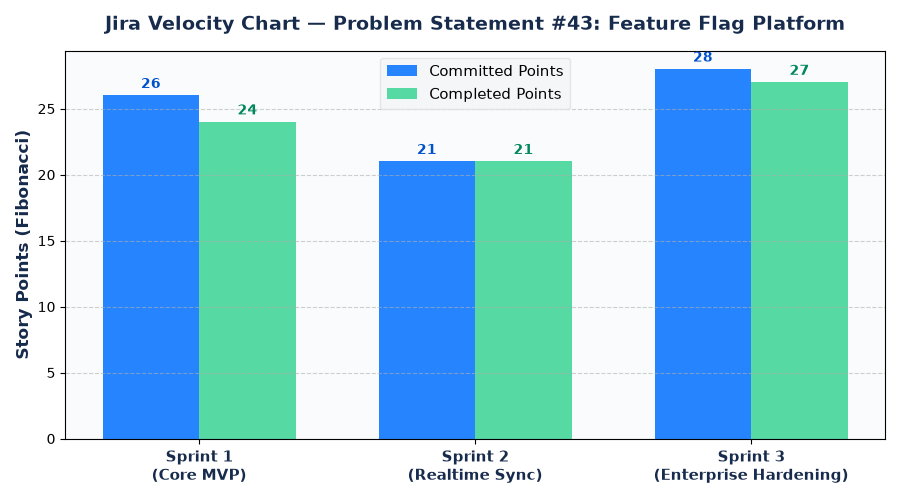
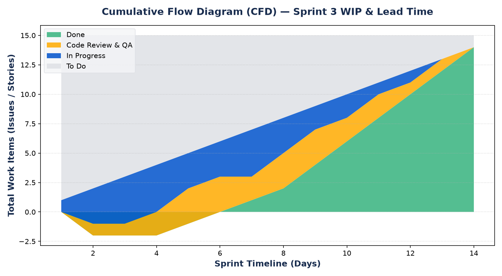
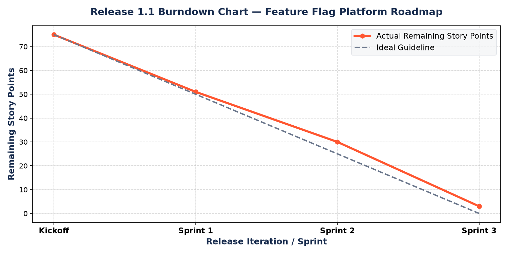
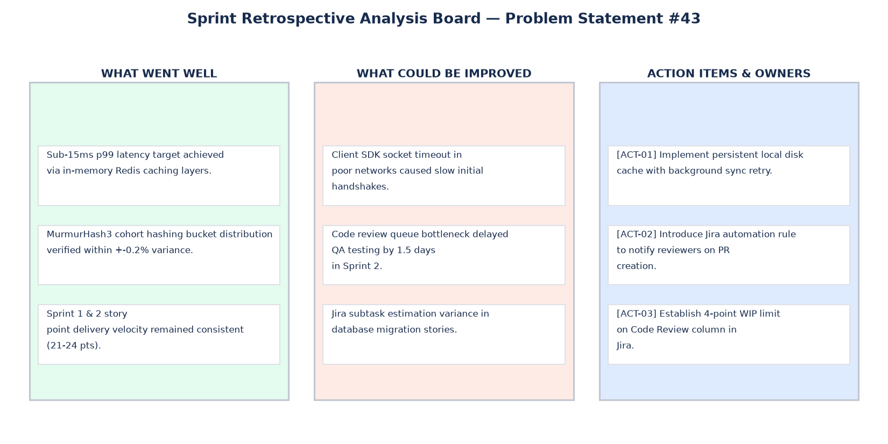

# Software Engineering Lab 3: Advanced Agile Project Management, Multi-Sprint Release Tracking & Quality Metrics in Jira

**Course**: Software Engineering Lab (UE24CS251A) — PES University (Dept. of CSE)  
**Student Name**: Sudeeksh Nayak  
**SRN**: `PES1UG24CS474`  
**Problem Statement ID**: #43  
**Domain**: Developer Tools & IT Operations  
**Topic**: Feature Flag & Dynamic Config Manager Platform  

---

## Deliverables Summary

| Deliverable File | Format | Description |
|---|---|---|
| [`SOFTWARE_ENGINEERING_LAB3_PES1UG24CS474.pdf`](SOFTWARE_ENGINEERING_LAB3_PES1UG24CS474.pdf) | PDF (`.pdf`) | Complete analytical report containing multi-sprint roadmap, custom Scrum workflow stages, velocity analysis, Cumulative Flow Diagrams (CFD), Jira automation rules, and sprint retrospective. |
| [`SOFTWARE_ENGINEERING_LAB3_PES1UG24CS474.docx`](SOFTWARE_ENGINEERING_LAB3_PES1UG24CS474.docx) | Word (`.docx`) | Microsoft Word source document with all embedded vector graphics, figures, tables, and formal evaluation rubrics. |
| [`Screenshots/`](Screenshots/) | Directory | Complete suite of high-resolution Jira screenshots covering Velocity Charts, CFD, Active Sprint 3 Board, Automation Rules, and Retrospective Boards. |

---

## 1. Advanced Backlog & Epic 2 Decomposition

Building upon the initial core MVP, **Epic 2: Enterprise Security, High-Scale Resilience & Client Telemetry** expands system capabilities for enterprise production deployment.

### User Stories & Fibonacci Estimation (Sprint 3)

| Story Key | User Story Description | Priority | Story Points | Acceptance Criteria |
|:---:|---|:---:|:---:|---|
| **US-08** | *As a Security Officer*, I want automated API key rotation and RBAC scoping, *so that* compromised client tokens are invalidated without downtime. | High | **5** | Zero unauthenticated requests succeed; token refresh executes in < 100 ms. |
| **US-09** | *As an SRE*, I want distributed edge Redis caching with background pre-warming, *so that* p99 latency remains under 15 ms during sudden rollout spikes. | High | **8** | p99 evaluation latency < 15 ms under 10,000 req/sec benchmark load. |
| **US-10** | *As a Client SDK Developer*, I want bi-directional SSE heartbeat pings and auto-reconnect logic, *so that* disconnected SDKs resume updates within 2 seconds. | Medium | **5** | SDK reconnects and synchronizes missing delta flag states within 2 seconds. |
| **US-11** | *As a Release Manager*, I want toggle flapping anomaly detection alerts (>10 toggles/min), *so that* accidental runaway script loops are caught instantly. | Medium | **3** | Automated Slack/Email webhook alert dispatched within 5 seconds of frequency trigger. |
| **US-12** | *As an SRE*, I want multi-region database replica failover with zero data loss, *so that* regional cloud outages do not interrupt flag evaluation paths. | High | **5** | Automatic failover completes in < 3s with zero read interruptions on live traffic. |

---

## 2. Multi-Stage Workflow & Active Sprint 3 Simulation

To reflect enterprise engineering standards, the board workflow was expanded into a five-stage pipeline with strict **Work-In-Progress (WIP)** limits:

$$\text{To Do} \longrightarrow \text{In Progress} \longrightarrow \text{Code Review (WIP: 4)} \longrightarrow \text{QA Testing (WIP: 3)} \longrightarrow \text{Done}$$

- **Code Review Quality Gate**: Every pull request requires approval from at least one senior peer before moving to QA.
- **WIP Limits**: Enforcing WIP limits of 4 on Code Review and 3 on QA prevented queue accumulation and reduced sprint cycle times.

---

## 3. Agile Automation Rules & SLA Triggers

Automated Jira Smart Rules were implemented to reduce manual overhead and enforce quality SLAs:

1. **Subtask Auto-Transition**: When all child implementation subtasks for a Story are marked `Done`, the parent Story automatically transitions to `Code Review`.
2. **SLA Incident Escalation**: Any defect labeled `P0-Critical` or `High` that remains in `In Progress` for over 24 hours triggers an automated Slack notification to the Release Manager.

---

## 4. Quantitative Metrics & Performance Analytics

### A. Velocity Charting Across Sprints
Tracking velocity across multiple iterations provides empirical grounding for future release capacity planning:
- **Sprint 1 (Core Engine)**: Committed: 26 pts | Completed: 24 pts (Velocity: 24)
- **Sprint 2 (Sync & Audit)**: Committed: 21 pts | Completed: 21 pts (Velocity: 21)
- **Sprint 3 (Enterprise Hardening)**: Committed: 28 pts | Completed: 27 pts (Velocity: 27)
- **Rolling Average Velocity**: **24.0 Story Points / Sprint**

### B. Cumulative Flow Diagram (CFD) & Lead Time
The CFD tracks total work items across all workflow stages over the 14-day sprint cycle, visually highlighting queue stability and flow efficiency.

### C. Release 1.1 Roadmap Burndown
Tracks progress toward the production Release 1.1 target milestone, validating that planned scope aligns with team velocity.

---

## 5. Sprint Retrospective & Continuous Improvement

At the close of Sprint 3, the engineering team held a structured Retrospective covering qualitative observations and concrete action items:

### Key Action Items & Ownership:
- **ACT-01 (Assigned to SDK Lead)**: Implement local SQLite disk caching with background retry threads to handle extended network outages gracefully.
- **ACT-02 (Assigned to DevOps Engineer)**: Deploy GitHub-Jira webhook integration to auto-link commit SHA hashes and test results directly to Jira issue tickets.
- **ACT-03 (Assigned to Scrum Master)**: Enforce a maximum WIP limit of 4 on the Code Review stage to eliminate PR review queues during mid-sprint peaks.

---

## 6. Analytical Reflection Questions & Answers

### Q1: How did the multi-sprint velocity trend inform capacity planning for Release 1.1?
> **Answer**: By tracking velocity across three full iterations, the team established a predictable baseline of 24.0 story points per sprint. This eliminated speculative commitment and allowed the team to scope Release 1.1 with high confidence, committing to exactly 28 points in Sprint 3 with only a minor 1-point variance at sprint close.

### Q2: What operational bottlenecks did the Cumulative Flow Diagram (CFD) reveal, and how were they mitigated?
> **Answer**: The CFD revealed a widening band in the 'Code Review' column between Days 5 and 9, indicating that engineers were pushing code faster than reviewers could review it. We addressed this by implementing a strict WIP limit of 4 on Code Review and establishing dedicated daily review windows.

### Q3: Why are automated Jira workflow rules critical in enterprise Agile delivery?
> **Answer**: Automated rules eliminate human oversight in routine status tracking and enforce quality gates. Automatically moving stories to review when subtasks complete ensures tickets always reflect actual repository state, while automated SLA alerts ensure critical production blockers receive immediate engineering attention.

### Q4: How did the Sprint Retrospective action items influence team process and quality?
> **Answer**: The retrospective established direct accountability for architectural and process debt. For example, Action Item ACT-01 directly solved SDK timeout issues identified during chaos testing, hardening the client against network drops and ensuring compliance with the 99.99% availability NFR.

---

## 7. Screenshot Index

| Screenshot File | Category | Description |
|---|---|---|
| [`Screenshots/Scrum_Backlog_Epic2.png`](Screenshots/Scrum_Backlog_Epic2.png) | Backlog | Product backlog showing Epic 2 stories and Fibonacci point estimates |
| [`Screenshots/Scrum_Sprint3_Active_Board.png`](Screenshots/Scrum_Sprint3_Active_Board.png) | Active Sprint | Multi-stage Scrum board showing work progression across 5 columns |
| [`Screenshots/Jira_Automation_Rule.png`](Screenshots/Jira_Automation_Rule.png) | Automation | Visual Jira automation rule for subtask synchronization |
| [`Screenshots/Scrum_Velocity_Chart.png`](Screenshots/Scrum_Velocity_Chart.png) | Metrics | Velocity chart across Sprint 1, Sprint 2, and Sprint 3 |
| [`Screenshots/Kanban_CFD_CumulativeFlow.png`](Screenshots/Kanban_CFD_CumulativeFlow.png) | Metrics | Cumulative Flow Diagram tracking WIP and cycle time |
| [`Screenshots/Scrum_Release_Burndown.png`](Screenshots/Scrum_Release_Burndown.png) | Metrics | Release 1.1 Burndown showing remaining work vs guideline |
| [`Screenshots/Sprint_Retrospective_Board.png`](Screenshots/Sprint_Retrospective_Board.png) | Retrospective | Retrospective board covering What Went Well, Improvements, and Actions |
